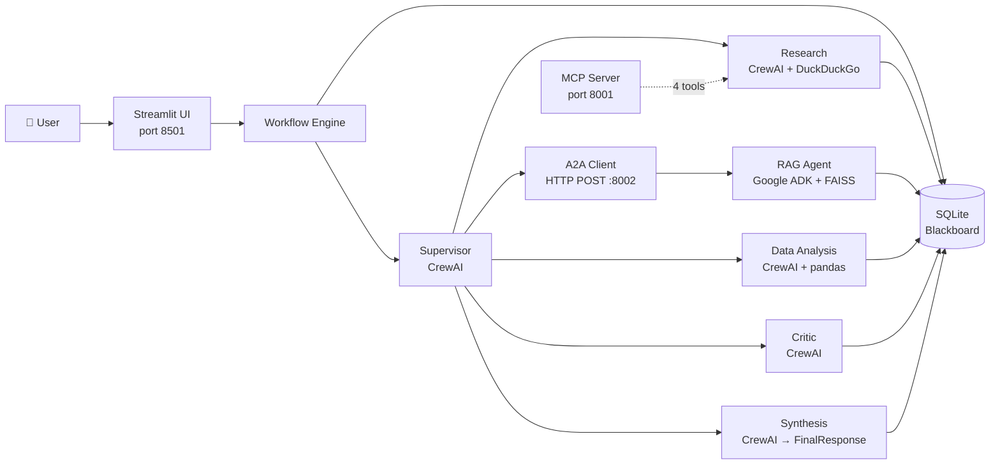

# Multi-Agent Research & Knowledge Assistant

A complete, runnable, cloud-deployable **Multi-Agent AI System** that answers complex knowledge-based queries by coordinating specialized agents for web research, document retrieval (RAG), data analysis, verification, and synthesis.

Built as a final-year project demonstrating:
- **CrewAI + Google ADK** cross-framework multi-agent orchestration
- **A2A protocol** for real HTTP-based cross-framework communication
- **MCP tools** (web search, document retrieval, calculator, data profiler)
- **SQLite Blackboard** shared state architecture
- **FAISS RAG** with sentence-transformers
- **Pydantic-validated** structured outputs
- **Streamlit UI** with 7 pages
- **Evaluation harness** (50 test cases × 4 patterns)
- **Google Cloud Run** deployment

---

## Architecture



---

## Quick Start

```powershell
# 1. Install dependencies
cd e:\PRJ-4\mas_project
pip install -r requirements.txt

# 2. Configure API key (edit .env)
copy .env.example .env
# → Open .env and set GOOGLE_API_KEY=your-key

# 3. Start background servers (new terminal)
python -m app.protocols.a2a.server    # A2A server  (port 8002)
python -m app.tools.mcp.server        # MCP server  (port 8001)

# 4. Launch the UI
streamlit run app/ui/app.py
# → Open http://localhost:8501
```

---

## Environment Variables

Edit `e:\PRJ-4\mas_project\.env` to change any setting:

| Variable | Default | Description |
|----------|---------|-------------|
| `GOOGLE_API_KEY` | *(required)* | Google Gemini API key |
| `CREWAI_LLM_MODEL` | `gemini/gemini-3.1-flash-lite` | CrewAI LiteLLM model string |
| `ADK_MODEL` | `gemini-3.1-flash-lite` | ADK model name |
| `LLM_TEMPERATURE` | `0.2` | LLM sampling temperature |
| `APP_ENV` | `development` | `development` or `production` |
| `LOG_LEVEL` | `INFO` | Python log level |
| `EMBEDDING_MODEL` | `all-MiniLM-L6-v2` | Sentence-transformers model |
| `CHUNK_SIZE` | `500` | RAG document chunk size |
| `RAG_TOP_K` | `5` | Number of RAG results |
| `MAX_QUERY_LENGTH` | `2000` | Input guardrail limit |
| `A2A_SERVER_PORT` | `8002` | ADK A2A server port |
| `MCP_SERVER_PORT` | `8001` | MCP tools server port |
| `BLACKBOARD_DB_PATH` | `data/blackboard.db` | SQLite database path |

**Available Gemini models for new accounts:**
- `gemini/gemini-3.1-flash-lite` ← fast, cheap (recommended)
- `gemini/gemini-3.1-pro-preview` ← most capable
- `gemini/gemini-3-flash-preview` ← alternative
- `gemini/gemini-flash-latest` ← always-latest alias

---

## Project Structure

```
mas_project/
├── app/
│   ├── agents/          # 6 agents (5 CrewAI + 1 ADK)
│   │   ├── supervisor/  ├── research/  ├── data_analysis/
│   │   ├── critic/      ├── synthesis/ └── rag/ (ADK)
│   ├── config/          # Settings + pricing
│   ├── evaluation/      # Harness + charts
│   ├── observability/   # Logger + metrics + tracer
│   ├── protocols/a2a/   # A2A server + client
│   ├── schemas/         # Pydantic models
│   ├── security/        # Guardrails + validators
│   ├── state/           # Blackboard + session store
│   ├── storage/         # FAISS vector store + doc processor
│   ├── tools/mcp/       # MCP server (4 tools)
│   ├── ui/              # Streamlit app (7 pages)
│   └── workflows/       # 4 patterns + engine
├── deployment/          # Cloud Run scripts + README
├── docs/                # 10 documentation files
├── evaluation_data/     # 50 test cases + results
├── tests/               # 146 tests (unit + e2e + integration + security)
├── .env.example         # Template — copy to .env
├── Dockerfile           # Cloud Run ready
├── requirements.txt
└── pyproject.toml
```

---

## Running Tests

```powershell
cd e:\PRJ-4\mas_project

# All tests (146 passing)
python -m pytest tests/ -m "not integration" -v

# Individual suites
python -m pytest tests/unit/test_guardrails.py -v   # 37 tests
python -m pytest tests/unit/test_blackboard.py -v   # 20 tests
python -m pytest tests/e2e/test_workflows.py -v     # 9 tests
python -m pytest tests/security/ -v                 # 26 tests

# Integration tests (requires A2A server running)
python -m pytest tests/integration/test_a2a.py -v -m integration
```

---

## Running the Evaluation

```powershell
cd e:\PRJ-4\mas_project

# 20 BASELINE runs (fast, low cost)
python -m app.evaluation.harness --patterns BASELINE --limit 20

# 25 BASELINE + 25 HIERARCHICAL = 50 runs (faculty requirement: ≥40)
python -m app.evaluation.harness --patterns BASELINE HIERARCHICAL --limit 25

# Generate charts from results
python -c "
from app.evaluation.charts import generate_all_charts, load_all_results
records = load_all_results()
generate_all_charts(records)
print('Charts saved to evaluation_data/results/charts/')
"
```

---

## Deployment (Google Cloud Run)

```bash
export GCP_PROJECT_ID=your-project-id
export GOOGLE_API_KEY=your-api-key
chmod +x deployment/cloud_run_deploy.sh
./deployment/cloud_run_deploy.sh
```

See [`deployment/README.md`](deployment/README.md) for full step-by-step instructions.

---

## Faculty Requirements

| # | Requirement | Implementation |
|---|------------|---------------|
| 1 | Blackboard architecture | `app/state/blackboard.py` |
| 2 | ≥2 MCP tools | `app/tools/mcp/server.py` (4 tools) |
| 3 | Pydantic structured output | `app/schemas/` |
| 4 | Hierarchical + parallel + sequential | `app/workflows/` |
| 5 | Monitoring callbacks | `app/observability/` |
| 6 | A2A cross-framework | `app/protocols/a2a/` |
| 7 | CrewAI + Google ADK | `app/agents/` |
| 8 | Guardrails | `app/security/` |
| 9 | Traceability / audit logs | Blackboard + observability |
| 10 | ≥40 evaluation runs | `app/evaluation/` |
| 11 | Cloud deployment | `Dockerfile` + `deployment/` |

See [`docs/requirement_matrix.md`](docs/requirement_matrix.md) for full evidence.

---

## Documentation

| Doc | Contents |
|-----|---------|
| [`docs/architecture.md`](docs/architecture.md) | System diagram, framework separation |
| [`docs/workflow.md`](docs/workflow.md) | 4 workflow patterns with sequence diagrams |
| [`docs/agents_and_tools.md`](docs/agents_and_tools.md) | Each agent's role, inputs, outputs, tools |
| [`docs/a2a_mcp_integration.md`](docs/a2a_mcp_integration.md) | A2A + MCP setup and usage |
| [`docs/blackboard_and_messaging.md`](docs/blackboard_and_messaging.md) | Blackboard schema, state machine, A2A flow |
| [`docs/security_and_guardrails.md`](docs/security_and_guardrails.md) | Threat model and mitigations |
| [`docs/observability.md`](docs/observability.md) | Logging, metrics, tracing |
| [`docs/evaluation_methodology.md`](docs/evaluation_methodology.md) | Hypotheses, metrics, test cases |
| [`docs/requirement_matrix.md`](docs/requirement_matrix.md) | 11 faculty requirements → evidence |
| [`docs/viva_questions.md`](docs/viva_questions.md) | 25 expected questions + answers |

---

## License

MIT License — see LICENSE file.
