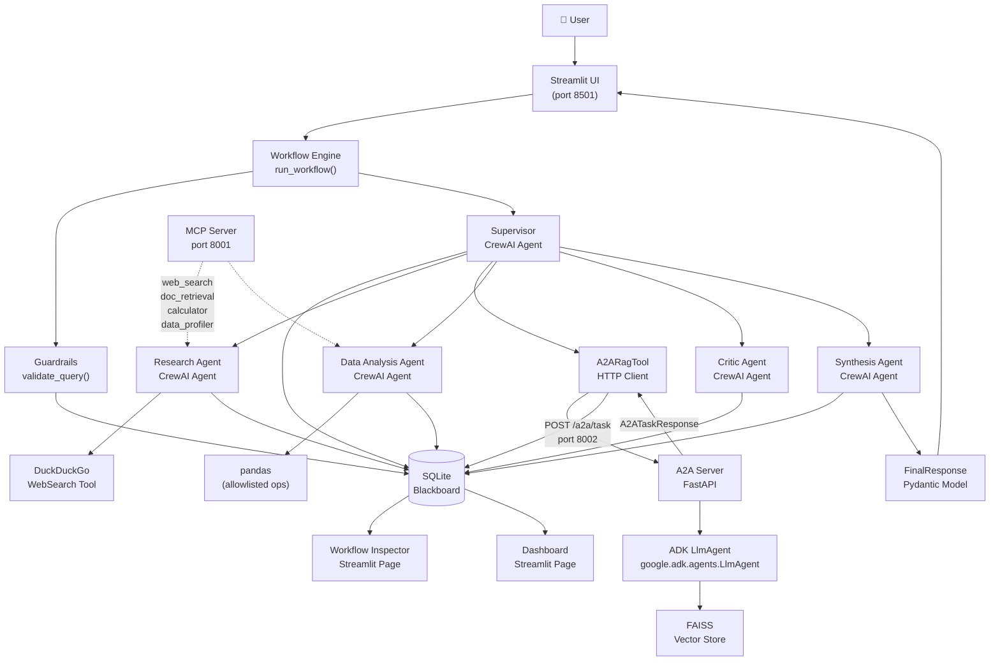

# System Architecture

## High-Level Overview

The Multi-Agent Research Assistant is a **Python-based AI system** that answers complex knowledge-based queries by coordinating six specialized agents across two frameworks (CrewAI + Google ADK), communicating via the A2A protocol, and maintaining shared state on a SQLite Blackboard.

```
┌─────────────────────────────────────────────────────────────┐
│                    Streamlit UI (port 8501)                  │
│   Chat | Documents | Data Analysis | Dashboard | Inspector   │
└────────────────────────┬────────────────────────────────────┘
                         │ run_workflow(query, pattern)
                         ▼
┌─────────────────────────────────────────────────────────────┐
│              Workflow Engine (app/workflows/engine.py)        │
│  validate_query → create_run → route to pattern → return     │
└──────┬──────────────┬──────────────┬───────────────┬────────┘
       │              │              │               │
  BASELINE      SEQUENTIAL     PARALLEL       HIERARCHICAL
       │              │              │               │
       ▼              ▼         ┌───┴───┐            ▼
  Single LLM    RAG→Critic   Res‖RAG   Supervisor→Research
  (no agents)   →Synthesis   →Synth    →RAG→Analysis
                             →Critic   →Critic→Synthesis
                         │              │               │
                         └──────────────┴───────────────┘
                                        │
                         ┌──────────────▼──────────────┐
                         │     SQLite BLACKBOARD        │
                         │  (shared state for all runs) │
                         └─────────────────────────────┘
```

---

## Framework Separation

| Component | Framework | File |
|-----------|-----------|------|
| Supervisor Agent | CrewAI | `app/agents/supervisor/agent.py` |
| Research Agent | CrewAI | `app/agents/research/agent.py` |
| Data Analysis Agent | CrewAI | `app/agents/data_analysis/agent.py` |
| Critic Agent | CrewAI | `app/agents/critic/agent.py` |
| Synthesis Agent | CrewAI | `app/agents/synthesis/agent.py` |
| RAG Agent | **Google ADK** | `app/agents/rag/adk_agent.py` |
| A2A Server (ADK side) | FastAPI + ADK | `app/protocols/a2a/server.py` |
| A2A Client (CrewAI side) | httpx | `app/protocols/a2a/client.py` |
| MCP Tools | FastMCP | `app/tools/mcp/server.py` |
| Blackboard | SQLite | `app/state/blackboard.py` |

---

## Full System Diagram



---

## Component Details

### Streamlit UI (7 pages)

| Page | Purpose |
|------|---------|
| Chat | Main query interface with pattern/persona selection |
| Documents | Upload + index PDFs/docs for RAG |
| Data Analysis | Upload CSVs, run analysis |
| Workflow Inspector | Browse Blackboard runs, events, audit log |
| Dashboard | Metrics, charts, evaluation results |
| Evaluation | Run/view evaluation harness |
| Settings | Health checks, config display, service management |

### CrewAI Agents

All CrewAI agents use `google.adk` via LiteLLM with the model string `gemini/gemini-3.1-flash-lite` (configurable in `.env`).

Each agent is built with:
```python
Agent(
    role="...",
    goal="...",
    backstory="...",
    tools=[...],
    llm=settings.get_crewai_llm(),
    verbose=True,
    allow_delegation=False,
    max_iter=5,
)
```

### Google ADK RAG Agent

Built with `google.adk.agents.LlmAgent`:
```python
LlmAgent(
    name="rag_agent",
    model="gemini-3.1-flash-lite",
    instruction="...",
    tools=[_rag_retrieval_fn],
)
```

Communicates with the CrewAI side exclusively via HTTP (A2A protocol). The ADK agent process is started independently as a FastAPI server.

### SQLite Blackboard

- **WAL mode** — concurrent reads while writing
- **Thread lock** — `threading.RLock` on all writes
- **Audit log** — immutable record of all state changes
- **Version counter** — optimistic concurrency tracking
- **`:memory:` support** — for unit testing (no disk I/O)

### FAISS Vector Store

- **Embedding model:** `sentence-transformers/all-MiniLM-L6-v2` (384 dimensions)
- **Index type:** `IndexFlatL2` (exact nearest-neighbour for development)
- **Chunking:** 500 tokens, 50-token overlap
- **Supported formats:** PDF, TXT, DOCX, JSON

### Security Architecture

```
Input → validate_query() → sanitized_query
          │
          ├─ Length check (max 2000 chars)
          ├─ Null/control byte check
          └─ Injection pattern blocklist (10+ patterns)

File → validate_file_upload() → safe_path, sha256_hash
          │
          ├─ Type whitelist (.pdf .txt .docx .json .csv)
          ├─ Size limit (50 MB)
          └─ Path traversal prevention

Retrieved content → validate_retrieved_content()
          │
          ├─ Truncation (max 50,000 chars)
          └─ Injection scan (warning, not rejection)
```

---

## Data Flow for a Typical Query

1. **User submits** query "What is climate change?" via Chat page with HIERARCHICAL pattern
2. **Engine** calls `validate_query()` → sanitized to "What is climate change?"
3. **Engine** calls `bb.create_run()` → `run_id = "abc-123"`
4. **Supervisor** calls `classify_query()` → `task_type=RESEARCH`, `agents_needed=["research","rag","critic","synthesis"]`
5. **Research Agent** calls `WebSearchTool("climate change")` → 5 DuckDuckGo results; writes `research_results` to Blackboard
6. **A2ARagTool** sends HTTP POST to A2A server → ADK agent searches FAISS (0 chunks if no docs indexed) → returns `{"answer": "No documents indexed", "success": true}`; writes `rag_results` to Blackboard
7. **Critic** reads `research_results` from Blackboard → verifies claims → writes `verification_results: PASS`
8. **Synthesis** reads all Blackboard fields → generates `FinalResponse` with citations
9. **Engine** returns `FinalResponse` to UI
10. **Streamlit** renders answer in Chat page with tabbed Sources, Evidence, JSON views

---

## Deployment Architecture (Cloud Run)

```
Internet
    │
    ▼
Google Cloud Run
┌──────────────────────────────────────────┐
│  Container (Python 3.12-slim, non-root)  │
│                                          │
│  ┌────────────┐  ┌──────────────────┐   │
│  │ Streamlit  │  │  A2A Server      │   │
│  │ port 8501  │  │  port 8002       │   │
│  │ (external) │  │  (in-process)    │   │
│  └────────────┘  └──────────────────┘   │
│                                          │
│  SQLite (ephemeral /app/data/)           │
│  FAISS (in-memory)                       │
└──────────────────────────────────────────┘
    │                    │
    ▼                    ▼
Secret Manager      Gemini API
(GOOGLE_API_KEY)    (external)
```

> [!WARNING]
> SQLite and FAISS data are lost on Cloud Run instance restarts.
> For production, use Cloud SQL (PostgreSQL) + Vertex AI Vector Search.
